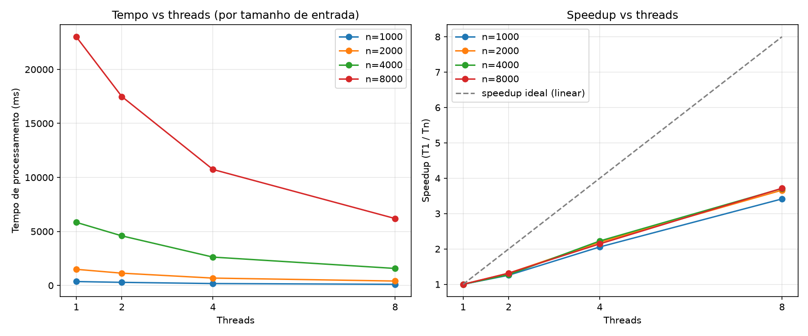

# Rota Vital

Backend do Projeto Integrador para gestão de bolsas de sangue e requisições hospitalares. A aplicação usa Spring Boot e consome estruturas de dados implementadas manualmente em Java, com versões equivalentes em C.

**Disciplinas:** Algoritmos e Estruturas de Dados (AED) e Infraestrutura de Software (SO). **Semestre:** 2026.2.

[Aplicação pública](https://rota-vital.onrender.com) · [Saúde da aplicação](https://rota-vital.onrender.com/actuator/health) · [Execuções do pipeline](https://github.com/Luizrocha0/Proj-EAD/actions)

## Estado das entregas

| Entrega | Conteúdo disponível | Situação |
| --- | --- | --- |
| AED U1 | Lista de estoque e fila FIFO em C e Java; testes; integração com a API; tradução comentada | Implementado |
| SO U1 | Endpoint sequencial/paralelo; medições; gráfico; relatório; CI/CD e configuração de deploy | Implementado |
| Infra U2 — Parte 1, até 20/10/2026 | Container com API e banco, TDD comprovável e deploy com gates e fluxo de PR | Planejado; implementação pendente |

O estoque e a fila atuais ficam **em memória** e são reiniciados junto com a aplicação. Esta versão não tem PostgreSQL, Compose nem perfis Spring `u1` e `infra`. Esses itens fazem parte do [plano de execução da Infra U2](docs/infra-u2/PROMPT_EXECUCAO_POR_ETAPAS.md).

## Integrantes e funções da equipe

As funções abaixo organizam a equipe para a **próxima entrega de Infra U2**. O detalhamento de responsabilidades, arquivos, revisões e prazos está na [divisão de funções](docs/infra-u2/divisao-tarefas.md).

| Integrante | Função | Responsabilidades |
| --- | --- | --- |
| Luiz Henrique Rocha | **Tech Leader** | Arquitetura, decisões técnicas, integração Java e revisão de PRs |
| Eduardo Borges | **Desenvolvedor Backend** | Domínio, migrações, persistência e operações da API |
| Eliziane Mota | **QA Engineer** | Critérios de aceite, TDD, testes e evidências de qualidade |
| Pedro Iranildo | **DevOps Engineer** | Docker/Compose, CI/CD, ambientes, deploy e rollback |
| Ricardo Severiano de Souza Filho | **Product Owner** | Backlog, escopo, prioridades, documentação e organização da entrega |

Os cinco integrantes compõem a equipe acadêmica. Os perfis identificados no histórico Git são [Luiz Henrique Rocha — @Luizrocha0](https://github.com/Luizrocha0) e [Ricardo Severiano de Souza Filho — @byteric](https://github.com/byteric). A divisão acima define trabalho futuro; não substitui o registro de autoria dos commits.

## Como rodar

### Requisitos

| Ferramenta | Uso |
| --- | --- |
| Java JDK 21 | Compilar, testar e executar a API; versão usada no CI |
| Maven Wrapper incluído | Baixar e executar a versão Maven do projeto |
| GCC e GNU Make em Linux/WSL | Testar as estruturas C com AddressSanitizer e UndefinedBehaviorSanitizer |
| Python 3.12+ | Validar medições e executar os scripts do relatório |
| Docker | Construir e executar a imagem existente; opcional na execução local da U1 |

A primeira execução do Maven Wrapper precisa de acesso à internet para baixar dependências.

### Linux, macOS ou WSL

```bash
git clone https://github.com/Luizrocha0/Proj-EAD.git
cd Proj-EAD
java -version
./mvnw spring-boot:run
```

### Windows — PowerShell

```powershell
git clone https://github.com/Luizrocha0/Proj-EAD.git
Set-Location Proj-EAD
java -version
.\mvnw.cmd spring-boot:run
```

Use `JAVA_HOME` apontando para seu JDK 21 instalado quando precisar selecionar essa versão. A aplicação escuta na porta 8080. Em outro terminal:

```bash
curl http://localhost:8080/actuator/health
```

O resultado esperado é HTTP 200 com `status` igual a `UP`. Interrompa a execução local com `Ctrl+C`.

### Docker existente

```bash
docker build -t rota-vital .
docker run --rm -p 8080:8080 --name rota-vital rota-vital
```

O Dockerfile atual tem estágios JDK/JRE e usuário sem privilégios. Seu estágio de build ainda usa `-DskipTests`; a correção e o Compose com banco estão previstos na Infra U2. Não há `docker compose up` funcional nesta versão.

## Funcionalidades e API

| Método | Endpoint | Comportamento |
| --- | --- | --- |
| POST | `/api/estoque` | Insere uma bolsa no início da lista |
| GET | `/api/estoque` | Retorna `bolsas` e `tamanho`, da inserção mais recente para a mais antiga |
| GET | `/api/estoque/{id}` | Consulta a primeira ocorrência do ID; retorna 404 se ausente |
| DELETE | `/api/estoque/{id}` | Remove a primeira ocorrência do ID; retorna 404 se ausente |
| POST | `/api/requisicoes` | Enfileira uma requisição |
| POST | `/api/requisicoes/atender` | Atende a próxima em ordem FIFO |
| GET | `/api/requisicoes/proxima` | Consulta a próxima sem removê-la |
| GET | `/api/requisicoes` | Lista as requisições pendentes |
| GET | `/api/duplicates/detect` | Detecta duplicatas sequencialmente ou com threads |
| GET | `/actuator/health` | Saúde da aplicação |
| GET | `/actuator/info` | Informações da aplicação |

O estoque aceita IDs repetidos. Consulta e remoção afetam a ocorrência mais recente. A prioridade da requisição é um campo de domínio; não altera a ordem FIFO. Não há histórico de operações com pilha nesta implementação.

### Cadastrar e consultar uma bolsa

Os comandos abaixo usam shell Bash; no PowerShell, envie o mesmo JSON com `Invoke-RestMethod` ou use `curl.exe` com a sintaxe apropriada ao seu terminal.

```bash
curl -X POST http://localhost:8080/api/estoque \
  -H 'Content-Type: application/json' \
  -d '{"id":"BOLSA-001","tipoSanguineo":"O+","volumeMl":"450.0","dataColeta":"2026-09-01","validade":"2026-11-01","doador":"Doador de exemplo"}'
curl http://localhost:8080/api/estoque/BOLSA-001
```

O POST retorna HTTP 200 com `mensagem` e `tamanho`. Os campos numéricos são enviados como texto para acompanhar o contrato atual do controller.

### Enfileirar e atender uma requisição

```bash
curl -X POST http://localhost:8080/api/requisicoes \
  -H 'Content-Type: application/json' \
  -d '{"id":"REQ-001","hospitalId":"HOSP-CENTRAL","tipoSanguineo":"O+","quantidadeBolsas":"2","prioridade":"EMERGENCIA"}'
curl http://localhost:8080/api/requisicoes/proxima
curl -X POST http://localhost:8080/api/requisicoes/atender
```

Fila vazia retorna HTTP 200 com uma mensagem. A operação de atendimento remove a requisição da fila; ela ainda não executa alocação de bolsa ou cálculo de rota.

### Testar o processamento com threads

```bash
curl 'http://localhost:8080/api/duplicates/detect?size=20&threads=1&mode=platform'
curl 'http://localhost:8080/api/duplicates/detect?size=20&threads=2&mode=platform'
```

Compare `status` e `duplicatesFound`. Os tempos variam entre chamadas. O controller aceita `size` de 1 a 20.000, modos `platform` e `virtual`, e limita `threads` a quatro vezes os processadores reconhecidos pela JVM. A série de 8 threads exige que a JVM reconheça pelo menos dois processadores.

## Testes

### Java

```bash
./mvnw clean verify
```

No PowerShell:

```powershell
.\mvnw.cmd clean verify
```

A suíte cobre estruturas AED, contexto Spring, controller de duplicatas, serviço sequencial/paralelo e comparação de textos. Os resultados reais ficam em `target/surefire-reports/`; consulte esses relatórios para a quantidade executada e as falhas. Não há, nesta versão, teste de integração com banco nem histórico TDD comprobatório da Infra U2.

### C

Execute em Linux/WSL com GCC e GNU Make:

```bash
make -C aed-c test
```

O Makefile ativa `-Wall -Wextra`, AddressSanitizer e UndefinedBehaviorSanitizer. A saída informa o resultado de cada suíte. Os testes cobrem inserção, consulta, remoção, vazio, ordem FIFO e reutilização das estruturas.

As fixtures JSON em [fixtures/](fixtures/) documentam os dados e resultados esperados. As suítes C e Java reproduzem esses valores diretamente no código; não carregam os arquivos JSON durante a execução. A [tradução comentada](docs/equivalencia-u1.md) relaciona as funções e os nós das duas versões.

### Cálculos do benchmark

```bash
python -m unittest discover -s bench -p 'test_*.py'
python bench/plot_speedup.py --check
```

Esses comandos verificam os cálculos e a correspondência entre CSV bruto e agregado sem refazer a coleta de desempenho. A opção `--check` não exige instalar as bibliotecas de geração de gráficos/PDF.

## Benchmark de threads

A detecção de duplicatas compara pares de textos usando distância de Levenshtein. O custo sequencial é O(n² · L²), para `n` registros com comprimento limitado por `L`. Contadores locais por fatia e agregação por `Future` permitem comparar a resposta sequencial com a paralela.

A série publicada em 06/10/2026 usa [40 observações brutas](bench/measurements.csv): tamanhos 8.000/16.000, modo `platform`, 1/2/4/8 threads e cinco repetições. Todas registram `SUCCESS`, com 3.198.218 pares duplicados para 8.000 registros e 12.801.507 para 16.000, iguais entre as versões.

| Tamanho | Threads | Média HTTP (ms) | Speedup |
| --- | --- | --- | --- |
| 8000 | 1 | 23883.00 | 1.00x |
| 8000 | 2 | 18925.60 | 1.26x |
| 8000 | 4 | 11105.20 | 2.15x |
| 8000 | 8 | 7209.80 | 3.31x |
| 16000 | 1 | 97867.00 | 1.00x |
| 16000 | 2 | 81400.00 | 1.20x |
| 16000 | 4 | 69518.20 | 1.41x |
| 16000 | 8 | 41297.40 | 2.37x |

A tabela usa a média de `responseTimeMs`, medida pelo cliente HTTP, e speedup `T1 / Tt` para o mesmo tamanho. `processingTimeMs` é uma métrica interna diferente. O [coletor PowerShell](bench/measure.ps1) prevê aquecimento antes da série.



A série não contém medições de virtual threads, hardware ou versão exata do JDK da coleta. Consulte [medições e limites](docs/medicoes.md), [justificativa](docs/justificativa.md), [análise](docs/analise.md) e [relatório PDF](docs/RotaVital_Threads_Relatorio.pdf).

### Gerar gráficos e relatório

Para regenerar os artefatos a partir dos CSVs preservados, use Python 3.12+ e as dependências fixadas de [bench/requirements.txt](bench/requirements.txt). Exemplo no PowerShell:

```powershell
python -m venv .venv-bench
.\.venv-bench\Scripts\python.exe -m pip install -r bench/requirements.txt
.\.venv-bench\Scripts\python.exe bench/plot_speedup.py
.\.venv-bench\Scripts\python.exe bench/build_report.py
```

Esses comandos geram arquivos; não representam uma nova medição de desempenho.

## Pipeline e deploy

O workflow [ci.yml](.github/workflows/ci.yml) executa em pushes para `main`/`develop` e em PRs destinados à `main`.

| Job | Verificação ou ação | Dependência |
| --- | --- | --- |
| `test-c` | Testes C com sanitizers | Checkout |
| `test-java` | JUnit com Java 21; relatórios Surefire | Checkout |
| `check-benchmark` | Testes Python e validação dos CSVs | Checkout |
| `build-java` | Empacotamento do JAR | `test-java` |
| `build-docker` | Construção da imagem | `test-c`, `build-java`, `check-benchmark` |
| `health-check` | Inicia o JAR e consulta Actuator, somente na main | `build-docker` |
| `deploy-render` | Dispara Render e consulta URL pública, somente na main | `health-check` |

O healthcheck do pipeline atual inicia o JAR, não uma composição API + banco. A construção da imagem não a publica em um registry. A Infra U2 acrescentará testes com banco, smoke do Compose, fluxo por PR/proteção e confirmação do commit publicado.

### Configuração do Render

[render.yaml](render.yaml) define serviço web Docker, branch main, healthcheck e `autoDeploy: false`; a publicação é disparada pelo workflow. Os secrets esperados no GitHub são:

| Nome | Finalidade |
| --- | --- |
| `RENDER_DEPLOY_HOOK_URL` | Hook de publicação; manter em segredo |
| `RENDER_APP_URL` | Endereço público usado pelo healthcheck do workflow |

A URL documentada é [https://rota-vital.onrender.com](https://rota-vital.onrender.com). A disponibilidade e o resultado de cada publicação devem ser conferidos na execução correspondente. Um HTTP 200, isoladamente, não identifica o commit servido.

O entrypoint atual usa `java -jar`; a variável `JAVA_OPTS` declarada no Blueprint ainda não é interpolada por ele. O ajuste de consumo dessa configuração integra o plano da Infra U2.

## Decisões técnicas

| Escolha atual | Alternativa considerada na organização | Justificativa ou limite |
| --- | --- | --- |
| Spring Boot + Java 21 | Script independente | Endpoint real de aplicação e stack do PI |
| Lista e fila com nós próprios | Coleções prontas | Demonstração das operações equivalentes às versões C |
| Estado em memória | Persistência relacional | Mantém a demonstração U1; o banco é trabalho da Infra U2 |
| C compilado separadamente | Chamar C pela JVM | Testar ponteiros e memória sem criar acoplamento nativo |
| ExecutorService e contadores locais | Contador compartilhado no laço | Agregar resultados após cada fatia sem disputa pelo contador |
| Imagem Temurin em dois estágios | Levar o JDK para a execução | Separar compilação e runtime, com usuário sem privilégios |
| GitHub Actions e Render | Deploy manual | Encadear testes, build e disparo de publicação |
| CSV bruto preservado | Digitar agregados no relatório | Tornar médias e speedup verificáveis a partir das observações |

A [divisão da Infra U2](docs/infra-u2/divisao-tarefas.md) e o [prompt por etapas](docs/infra-u2/PROMPT_EXECUCAO_POR_ETAPAS.md) registram a evolução planejada. PostgreSQL, JDBC, Flyway e os perfis propostos ainda não são capacidades desta versão.

## Uso de IA

Foi usada assistência de IA na revisão dos requisitos, planejamento, documentação e correção/validação dos agregados do benchmark. A implementação futura da Infra U2 também possui um prompt de execução por etapas, ainda apresentado como plano. O grupo deve revisar, executar e compreender os artefatos antes da entrega.

Principais solicitações registradas nesta colaboração:

- “Verifica pra mim se agora a entrega obedece todos os requisitos de ambas as matérias.”
- “gere um prompt completo de como fazer isso de acordo com o que tem no repositório. Seja rigido e direto com tudo.”
- “faça um arquivo md com tudo isso. E peça pra ele fazer coisas por parte, fazendo etapa por etapa.”
- Organização do README, dos créditos e da divisão das tarefas entre os integrantes.

O [prompt completo](docs/infra-u2/PROMPT_EXECUCAO_POR_ETAPAS.md) exige testes e evidências reais. Assistência de IA não comprova retrospectivamente TDD nem atribui trabalho executado a quem está apenas indicado no planejamento.

## Organização e documentos

| Caminho | Conteúdo |
| --- | --- |
| `src/main/java/com/rotavital/aed/u1/` | Lista e fila manuais em Java |
| `src/main/java/com/rotavital/controller/` | Estoque, requisições e duplicatas |
| `src/main/java/com/rotavital/service/` | Serviços de aplicação e processamento |
| `src/test/` | Testes de estrutura, controller, serviço, utilitário e contexto |
| `aed-c/` | Headers, implementações C, testes e Makefile |
| `bench/` | Medições, testes de cálculo e geradores de artefatos |
| `docs/` | Tradução, análise, justificativa e relatório |
| `docs/infra-u2/` | Divisão de tarefas e execução planejada por etapas |

O [plano original de setembro](PLANO_ENTREGA_AED_SO.md) é um registro histórico. Para o estado atual, use este README; para as novas responsabilidades, use a [divisão de tarefas](docs/infra-u2/divisao-tarefas.md).

## Histórico e coautoria

Os rodapés de coautoria foram organizados para os dois contribuidores identificados no GitHub, preservando autores, datas de autoria, datas de commit e os arquivos de cada uma das 12 versões anteriores. A alteração dos metadados muda os SHAs. O [histórico anterior](https://github.com/Luizrocha0/Proj-EAD/tree/archive/main-before-coauth-20261016) permanece em uma branch de backup; o [mapeamento dos commits](docs/historico-coautoria.json) permite conferir a correspondência.

Os novos documentos usam a data real da atualização. A distribuição das tarefas identifica responsabilidades futuras e não altera as datas acadêmicas das entregas anteriores.

Quem já possui um clone anterior deve preservar suas alterações locais e usar um novo clone para trabalhar na main reorganizada, evitando unir os dois históricos.

## Uso acadêmico

Projeto acadêmico do semestre 2026.2, desenvolvido para as disciplinas de AED e Infraestrutura de Software.
