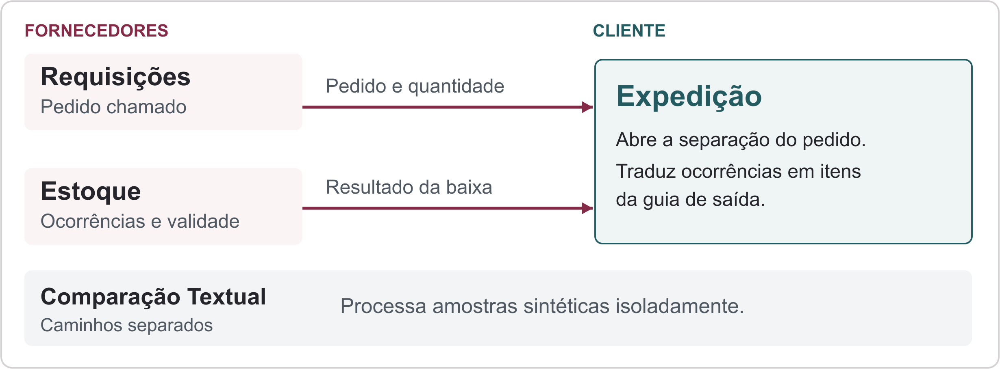
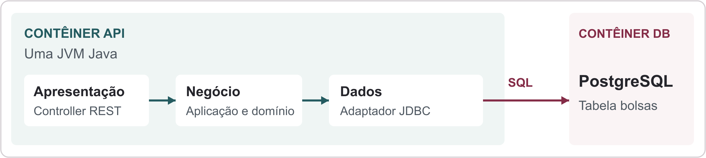

# Rota Vital

**Planejamento da remodelagem | Pré-entrega das seções A e C**

Infraestrutura de Software · ADS · CESAR School · 2026.2

**Squad Rota Vital** · 17/11/2026 · 19h15

Eduardo Borges, Luiz Henrique Rocha, Eliziane Mota, Pedro Iranildo e Ricardo Severiano de Souza Filho.

[Repositório do projeto](https://github.com/Luizrocha0/Proj-EAD) · [Versão analisada 9146831](https://github.com/Luizrocha0/Proj-EAD/tree/9146831c886994d4229bc1e5feba4b10e2825ad8)

## A. Remodelagem do domínio

### Como funciona hoje

O Rota Vital expõe três fluxos pela API Java. Estoque cadastra, consulta, lista e remove bolsas. Requisições organiza pedidos hospitalares por ordem de chegada. Duplicatas compara nomes sintéticos de medicamentos e conta pares semelhantes.

O diretório `aed-c/` contém a lista e a fila originais. A API usa suas versões Java. Os scripts em `bench/` medem o desempenho da comparação textual.

Atender um pedido hoje significa retirá-lo da fila. A resposta HTTP identifica o pedido retirado. O serviço não consulta estoque nem confirma a saída.

### Subdomínios e bounded contexts propostos

| Subdomínio e classe | Justificativa da classificação | Bounded context e responsabilidade |
| --- | --- | --- |
| Controle de bolsas · **core** | Saber quais unidades podem sair sustenta o atendimento hospitalar. | **Estoque** controla as ocorrências, a validade e a baixa das bolsas. |
| Atendimento hospitalar · **core** | A ordem de atendimento determina qual demanda será tratada. | **Requisições** registra a necessidade do hospital e chama pedidos em ordem de chegada. |
| Documentação da saída · **suporte** | A guia registra o resultado da separação para conferência. | **Expedição** associa o pedido às unidades liberadas e emite sua guia. |
| Comparação textual · **genérico** | O mesmo cálculo de semelhança serve a vários domínios. | **Comparação Textual** conta pares semelhantes em amostras sintéticas. |

Expedição é uma capacidade proposta. Os outros três contextos reorganizam comportamentos existentes. A confirmação de baixa para um pedido também é nova.

<!-- pagina -->

## A. Mapa de contextos



As setas partem do fornecedor e apontam ao cliente. Representam dependência entre modelos. As integrações propostas funcionam dentro da mesma aplicação.

### Contratos nas fronteiras

| Relação | Contrato e tradução |
| --- | --- |
| **Requisições fornece a Expedição** | Ao chamar o pedido, Requisições disponibiliza seu identificador, hospital, tipo solicitado e quantidade. Expedição abre uma separação para esse pedido. |
| **Estoque fornece a Expedição** | Expedição solicita a baixa informando pedido, tipo e quantidade. Estoque verifica a disponibilidade e a validade na data de referência. Confirma as ocorrências baixadas ou informa insuficiência. |
| **Camada anticorrupção em Expedição** | O adaptador traduz ocorrências confirmadas em itens de guia. Cada item referencia uma ocorrência específica. O identificador público pode repetir. O doador fica no Estoque. |
| **Comparação Textual adota caminhos separados** | O algoritmo recebe textos do gerador sintético. Nenhum dos outros contextos consome sua contagem. |

### Um pedido que a fila sozinha não resolve

Nas amostras do projeto, `REQ-005` pede quatro bolsas O−. Em 17/11/2026, apenas `BOLSA-005` tem esse tipo e continua válida. Sua validade termina em 20/11/2026.

Quando esse pedido chegar à frente, Requisições poderá chamá-lo. Na proposta, Estoque informa insuficiência e preserva a unidade. A separação permanece pendente em Expedição. **A guia exige a quantidade integral confirmada.** Essa regra parcial segue para discussão em sala.

Dados do exemplo · [Requisições sintéticas](https://github.com/Luizrocha0/Proj-EAD/blob/9146831c886994d4229bc1e5feba4b10e2825ad8/fixtures/requisicoes_u1.json) · [Bolsas sintéticas](https://github.com/Luizrocha0/Proj-EAD/blob/9146831c886994d4229bc1e5feba4b10e2825ad8/fixtures/bolsas_u1.json)

<!-- pagina -->

## A. Glossário da linguagem ubíqua

O contexto define o significado de cada termo. A palavra **bolsa** muda entre o inventário e a guia.

| Termo | Contexto | Significado no Rota Vital |
| --- | --- | --- |
| **Bolsa** | Estoque | Unidade cadastrada com tipo sanguíneo, volume, coleta e validade. |
| **Bolsa** | Expedição | Item da guia que identifica uma unidade liberada. |
| **Ocorrência** | Estoque | Um registro individual, mesmo quando seu identificador público se repete. |
| **Validade** | Estoque | Última data válida. A bolsa vence no dia seguinte. |
| **Tipo sanguíneo** | Estoque | Grupo e fator registrados na unidade, como O−. |
| **Baixa** | Estoque | Saída confirmada de uma ocorrência para determinado pedido. |
| **Requisição** | Requisições | Pedido hospitalar com tipo solicitado e quantidade de bolsas. |
| **Hospital solicitante** | Requisições | Unidade identificada no pedido como origem da demanda. |
| **Prioridade** | Requisições | Urgência declarada. Hoje a ordem continua sendo de chegada. |
| **Fila** | Requisições | Sequência na qual o primeiro pedido recebido sai primeiro. |
| **Chamada** | Requisições | Retirada do primeiro pedido para iniciar seu atendimento. |
| **Separação** | Expedição | Acompanhamento do pedido até confirmar as unidades de saída. |
| **Guia de saída** | Expedição | Documento que relaciona pedido, hospital e ocorrências liberadas. |
| **Par semelhante** | Comparação Textual | Dois registros cuja distância de Levenshtein vale até dois. |

O estoque legado lista primeiro a ocorrência mais recente. Consultar ou remover um identificador repetido alcança essa ocorrência. A expressão **baixa** designa a nova operação vinculada ao pedido. A remoção atual por identificador continua tendo significado próprio.

<!-- pagina -->

## C. Arquitetura em três camadas

### Responsabilidades e dependências

O monólito proposto organiza o código por contexto. Cada contexto separa apresentação, negócio e dados.

| Camada lógica | Responsabilidade e exemplo |
| --- | --- |
| **Apresentação** | O `EstoqueController` exemplifica essa fronteira. Recebe HTTP, valida o formato e traduz respostas. O repositório oferece uma API, sem telas próprias. |
| **Negócio** | A aplicação coordena casos de uso. O domínio decide regras, como vencimento e quantidade para baixa. `ConfirmarBaixa` reúne as unidades e aplica essas regras. |
| **Dados** | Repositórios e adaptadores executam persistência e integrações. O adaptador JDBC acessa o PostgreSQL. Em Expedição, adaptadores traduzem os contratos dos fornecedores. |

**Regra de dependência.** Apresentação chama negócio. Negócio acessa dados mediante contratos definidos pela aplicação. Dados implementa os contratos. O domínio usa tipos Java e regras próprias. Controllers, SQL e Spring ficam fora do domínio.

### Onde cada parte executa



O Compose inicia os serviços `api` e `db`. Controllers, casos de uso, domínio e adaptadores executam na JVM. O PostgreSQL roda em outro contêiner, com volume persistente. O perfil `infra` persiste apenas o estoque hoje. Requisições mantém a fila em memória nos dois perfis.

Com `u1`, o estoque usa uma lista encadeada na JVM. O Render descreve um serviço web e PostgreSQL gerenciado. Esses arranjos físicos comportam as mesmas três camadas lógicas.

Configurações analisadas · [Docker Compose](https://github.com/Luizrocha0/Proj-EAD/blob/9146831c886994d4229bc1e5feba4b10e2825ad8/compose.yaml) · [Blueprint do Render](https://github.com/Luizrocha0/Proj-EAD/blob/9146831c886994d4229bc1e5feba4b10e2825ad8/render.yaml)

<!-- pagina -->

## C. Estrutura de pacotes proposta

A raiz Java atual é `com.rotavital`. A árvore mostra os quatro módulos e suas responsabilidades.

```text
com.rotavital
├── estoque
│   ├── apresentacao          EstoqueController
│   ├── negocio
│   │   ├── aplicacao         ConsultarEstoque, ConfirmarBaixa, EstoqueStorage
│   │   └── dominio           Bolsa, Ocorrencia, Validade
│   └── dados                 JdbcEstoqueStorage, ListaEstoqueStorage
├── requisicoes
│   ├── apresentacao          RequisicaoController
│   ├── negocio
│   │   ├── aplicacao         EnfileirarPedido, ChamarProximo
│   │   └── dominio           Requisicao, Prioridade
│   └── dados                 FilaEmMemoria
├── expedicao
│   ├── apresentacao          ExpedicaoController
│   ├── negocio
│   │   ├── aplicacao         AbrirSeparacao, EmitirGuia
│   │   └── dominio           Separacao, GuiaDeSaida, ItemDeGuia
│   └── dados                 AdaptadorEstoque, AdaptadorRequisicoes
└── comparacaotextual
    ├── apresentacao          DuplicateController
    ├── negocio
    │   ├── aplicacao         DetectarPares
    │   └── dominio           DistanciaDeLevenshtein
    └── dados                 GeradorDeAmostrasSinteticas
```

**Exemplo de execução.** Uma consulta chega ao `EstoqueController`. O caso de uso consulta o contrato `EstoqueStorage`. O perfil seleciona o adaptador de lista ou JDBC. A resposta HTTP volta pelo controller.

### Evidências no código

O serviço mostra a retirada da fila. A migração distingue identificador público e chave técnica. Os testes JDBC especificam qual ocorrência deve ser consultada.

[Serviço de requisições](https://github.com/Luizrocha0/Proj-EAD/blob/9146831c886994d4229bc1e5feba4b10e2825ad8/src/main/java/com/rotavital/service/RequisicaoService.java) · [Migração de bolsas](https://github.com/Luizrocha0/Proj-EAD/blob/9146831c886994d4229bc1e5feba4b10e2825ad8/src/main/resources/db/migration/V1__criar_tabela_bolsas.sql) · [Testes de estoque JDBC](https://github.com/Luizrocha0/Proj-EAD/blob/9146831c886994d4229bc1e5feba4b10e2825ad8/src/test/java/com/rotavital/integration/JdbcEstoqueStorageIT.java)

### Uso de IA

OpenAI Codex auxiliou na leitura, modelagem, redação e diagramação. Na seção A, controllers, serviços e amostras sintéticas fundamentaram o contraste entre chamada e baixa. Na seção C, pacotes, perfis, migração SQL e Compose fundamentaram a distribuição física. Os testes versionados serviram como referência dos contratos legados. As fronteiras propostas aguardam a devolutiva em sala.
