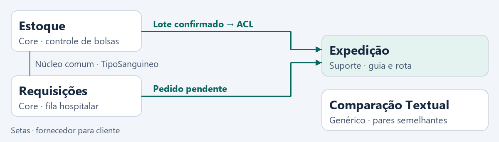
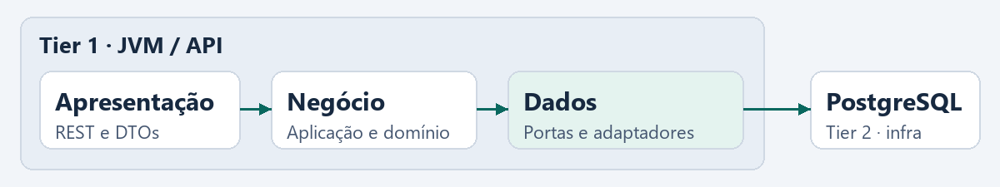
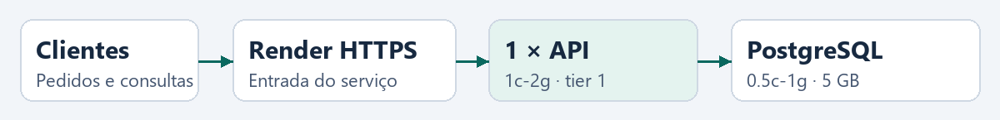
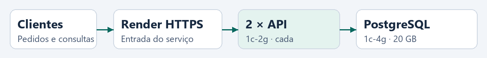
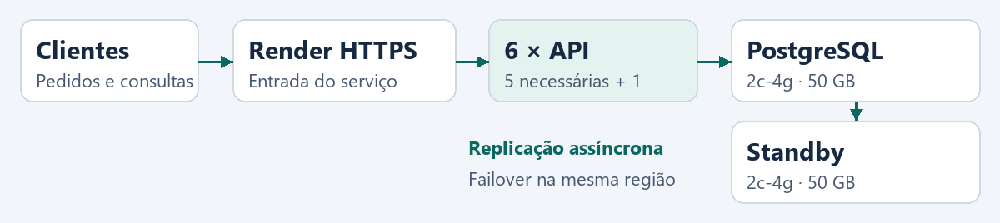

# Rota Vital

## Planejamento da remodelagem

**Trabalho U2 · Parte 2 · Infraestrutura de Software**

ADS · CESAR School · 2026.2 · Entrega em 24/11/2026

**Squad Rota Vital**

Eduardo Borges, Luiz Henrique Rocha, Eliziane Mota, Pedro Iranildo e Ricardo Severiano de Souza Filho.

[Repositório Luizrocha0/Proj-EAD](https://github.com/Luizrocha0/Proj-EAD)

### Ponto de partida

A pré-entrega analisava a fila antes da baixa integrada. A AED passou a calcular a rota, selecionar pelo vencimento e baixar a quantidade integral. A fila ainda era local à JVM no perfil `infra`. A remodelagem usa a revisão `4ee3de0` como referência.

### A · Remodelagem com DDD

| Subdomínio | Classificação e justificativa | Contexto e responsabilidade |
| --- | --- | --- |
| Controle de bolsas | **Core.** Disponibilidade e validade determinam quais bolsas podem sair. | **Estoque** registra ocorrências e confirma lotes de baixa. |
| Atendimento hospitalar | **Core.** A ordem FIFO organiza as demandas pendentes. | **Requisições** registra demandas e controla o consumo da fila. |
| Documentação e percurso | **Suporte.** A expedição documenta e orienta a saída. | **Expedição** coordena atendimento, calcula percurso e emite a guia. |
| Comparação textual | **Genérico.** A mesma métrica atende outros conjuntos de textos. | **Comparação Textual** conta pares semelhantes em amostras sintéticas. |



<!-- pagina -->

## A · Contratos e linguagem ubíqua

| Relação | Contrato |
| --- | --- |
| Requisições → Expedição · fornecedor e cliente | A Expedição recebe o próximo pedido pelo serviço de aplicação. O contrato oferece identidade, destino, tipo e quantidade da demanda. |
| Estoque → Expedição · fornecedor e cliente | O Estoque recebe o tipo receptor, a quantidade e a data. Devolve um lote integral ou sinaliza insuficiência. |
| Estoque → Expedição · camada anticorrupção | `AdaptadorEstoque` traduz cada ocorrência em item de guia. A tradução preserva a chave técnica internamente. Os dados do doador ficam no Estoque. |
| Comparação Textual · caminhos separados | O gerador sintético fornece as amostras. Os demais contextos têm fluxos independentes. |
| Estoque ↔ Requisições · núcleo compartilhado | `TipoSanguineo` representa os rótulos usados pelos dois modelos. Compatibilidade segue a matriz adotada pela AED. |

| Termo | Contexto | Significado |
| --- | --- | --- |
| **Bolsa** | Estoque | Unidade cadastrada, com coleta, volume e validade. |
| **Bolsa** | Expedição | Item da guia referente a uma unidade liberada. |
| Ocorrência | Estoque | Registro individual, identificado por chave técnica. |
| ID público | Estoque | Identificador visível que pode se repetir. |
| Validade | Estoque | Última data em que a bolsa ainda é válida. |
| FEFO | Estoque | A unidade elegível com validade mais próxima sai primeiro. |
| Baixa | Estoque | Retirada integral das ocorrências selecionadas para o pedido. |
| Lote de baixa | Estoque | Conjunto validado de ocorrências que satisfaz a demanda. |
| Requisição | Requisições | Pedido identificado, com hospital, tipo e quantidade solicitados. |
| Prioridade | Requisições | Urgência declarada. A ordem de atendimento continua FIFO. |
| Cabeça da fila | Requisições | Primeiro pedido pendente, elegível para iniciar o atendimento. |
| Guia de saída | Expedição | Resultado que reúne pedido, hospital e ocorrências liberadas. |
| Rota | Expedição | Percurso sintético entre a origem, paradas e hospital de destino. |
| Par semelhante | Comparação Textual | Dois registros com distância de Levenshtein até dois. |

<!-- pagina -->

## B · Modelo tático de Estoque

### Agregado Lote de Baixa

| Papel | Modelo e responsabilidade |
| --- | --- |
| **Raiz** | `LoteDeBaixa` confirma uma seleção e guarda a lista imutável. |
| **Entidade interna** | `OcorrenciaBolsa` identifica uma unidade pela chave técnica. |
| **Objetos de valor** | `PedidoDeBaixa` reúne tipo receptor, quantidade positiva e data. `TipoSanguineo` representa os rótulos e sua compatibilidade. `LocalDate` representa a data de validade e referência. |
| **Preparação e persistência** | A política FEFO prepara o lote. O adaptador executa a retirada pelas chaves. O PostgreSQL compartilha a transação com a fila. |

**Invariantes.** A raiz confirma exatamente a quantidade solicitada. Cada chave aparece uma única vez. Toda ocorrência deve ser compatível e válida. A validade inclui a própria data. IDs públicos iguais podem identificar ocorrências distintas.

### História âncora

Como pessoa operadora de estoque, quero confirmar a baixa integral do próximo pedido. Assim, a expedição recebe a quantidade solicitada pelo hospital.

| Critério de aceite | Evidência |
| --- | --- |
| CA1 · Quantidade integral, tipos compatíveis e validade inclusiva. | `LoteDeBaixaTest` e `AtendimentoAedTest`. |
| CA2 · Insuficiência retorna 409 e preserva fila e estoque. | `AtendimentoAedTest`. |
| CA3 · Entre ocorrências elegíveis, vence primeiro a menor validade. | `AlgoritmosAedTest` e `AtendimentoAedIT`. |
| CA4 · Uma falha no consumo reverte a baixa. | `FilaCompartilhadaIT` com PostgreSQL real. |

### Cenário Gherkin

```gherkin
Cenário: Estoque insuficiente preserva a demanda
  Dado que o próximo pedido exige duas bolsas O-
  E que apenas uma ocorrência O- está válida
  Quando a pessoa operadora solicita o atendimento
  Então a API retorna 409 por estoque insuficiente
  E preserva as ocorrências e o pedido pendente
```

O cenário completo inclui reposição e nova tentativa. A execução das etapas Gherkin está prevista para a Parte 3. A Parte 2 valida os comportamentos equivalentes com JUnit e MockMvc.

[Cenário completo em Gherkin](atendimento-integral.feature)

<!-- pagina -->

## C · Arquitetura em três camadas

| Camada lógica | Onde ficam as responsabilidades |
| --- | --- |
| **Apresentação** | Controllers e DTOs recebem HTTP e traduzem respostas. A interface disponível é a API REST. |
| **Negócio** | Os casos de uso coordenam a operação. As entidades protegem as regras. |
| **Dados** | Adaptadores executam JDBC, estruturas encadeadas e tradução entre contextos. |

Apresentação chama os casos de uso. Aplicação acessa dados por portas próprias. Os adaptadores implementam essas portas. Domínio usa Java e suas regras de negócio. Spring e SQL ficam nas fronteiras e na composição.

```text
com.rotavital
├── estoque
│   ├── apresentacao       EstoqueController
│   ├── negocio.aplicacao  EstoqueService, EstoqueStorage
│   ├── negocio.dominio    Bolsa, LoteDeBaixa, PedidoDeBaixa
│   └── dados              JdbcEstoqueStorage, ListaEstoqueStorage
├── requisicoes
│   ├── apresentacao       RequisicaoController
│   ├── negocio.aplicacao  RequisicaoService, FilaDeRequisicoes
│   ├── negocio.dominio    Requisicao
│   └── dados              FilaJdbc, FilaEmMemoria
├── expedicao
│   ├── apresentacao       AtendimentoController
│   ├── negocio.aplicacao  AtenderRequisicao, BaixaParaExpedicao
│   ├── negocio.dominio    GuiaDeSaida, Roteirizador
│   └── dados              AdaptadorEstoque
├── comparacaotextual
│   ├── apresentacao       DuplicateController
│   ├── negocio.aplicacao  DetectarPares, GeradorDeAmostras
│   ├── negocio.dominio    DuplicateDetectionService, FuzzyMatcher
│   └── dados              DataGeneratorService
├── comum.dominio          TipoSanguineo, ConflitoAtendimentoException
├── aed                    Estruturas e algoritmos compartilhados da AED
└── config                 Composição dos casos de uso e DataSource
```



No perfil `u1`, fila e estoque vivem na JVM. No perfil `infra`, o Compose conecta dois contêineres. No Render, o blueprint define uma API e PostgreSQL gerenciado. A guia é emitida na resposta do atendimento.

<!-- pagina -->

## D · Projeção com microsserviços

| Serviço futuro | Motivo e comunicação | Dados sob sua responsabilidade |
| --- | --- | --- |
| Requisições | Admite pedidos via REST. Publica `PedidoChamado` pela fila de mensagens. | PostgreSQL próprio para pedidos, posição e estado. |
| Estoque | Recebe comandos de reserva, liberação e baixa. Publica o resultado. | PostgreSQL próprio para ocorrências e reservas. |
| Expedição | Coordena a saga, calcula rota e emite a guia. Expõe consultas via REST. | PostgreSQL próprio para atendimento, guia e estado da saga. |
| Comparação Textual | Serviço CPU-intensivo. Pode escalar independentemente via REST. | Amostras geradas localmente e processamento sem estado. |

### Saga de atendimento

1. Requisições chama a cabeça da fila. Uma transação grava o estado e o evento na outbox.
2. Expedição verifica o percurso. Em seguida, solicita a reserva integral das ocorrências.
3. Estoque reserva o lote FEFO e confirma a reserva. Expedição prepara a guia em estado pendente.
4. Estoque confirma a baixa. Expedição publica a guia e Requisições encerra o pedido.
5. Se a operação falhar antes da baixa, Estoque libera as reservas. Expedição cancela a guia pendente. Requisições devolve o pedido à posição original.

O identificador da saga acompanha todos os comandos. Consumidores deduplicam mensagens. A outbox preserva a publicação após o commit. Após a baixa, a saga retenta as confirmações finais. A reconciliação cobre falhas persistentes sem devolver unidades já liberadas.

| Dimensão | Monólito modular adotado | Microsserviços projetados |
| --- | --- | --- |
| Deploy | Uma imagem para a API inteira. | Deploy por serviço e contratos versionados. |
| Escala | Réplicas da API completa. | Réplicas por carga e isolamento do trabalho textual. |
| Consistência | Transação única para baixa e fila. | Consistência eventual entre bancos, com saga. |
| Custo | Uma API e um banco por ambiente. | Vários runtimes, bancos, mensageria e telemetria. |
| Operação | Logs e diagnóstico no mesmo processo. | Rastreio distribuído, reentregas e reconciliação. |

[ADR 0001 · Decomposição](../adr/0001-decomposicao.md) · [ADR 0002 · Fila e baixa](../adr/0002-fila-e-baixa-atomicas.md)

| ADR | Contexto | Decisão e consequências |
| --- | --- | --- |
| **0001 · Decomposição** | Uma equipe opera a API. Baixa e fila precisam confirmar juntas. | Adotar monólito modular. A transação local simplifica o atendimento. O processo compartilha recursos entre contextos. |
| **0002 · Transação** | A fila local se perdia ao reiniciar a JVM. | Persistir a fila junto ao Estoque no perfil `infra`. Réplicas compartilham os pedidos. O bloqueio serializa as escritas. |

<!-- pagina -->

## E · Cenários de carga e capacidade

As premissas representam um mês de 30 dias. A taxa de pico é a média na janela mais carregada de 15 minutos. Usuários e pedidos são estimativas sintéticas. Disponibilidade é objetivo de planejamento.

| Premissa | Baixo | Moderado | Alto |
| --- | ---: | ---: | ---: |
| Usuários ativos por dia | 30 | 150 | 750 |
| Pedidos hospitalares por dia | 120 | 900 | 5.000 |
| Pedidos por mês | 3.600 | 27.000 | 150.000 |
| Pico HTTP por segundo | 8 | 60 | 240 |
| Disponibilidade desejada | 99,0% | 99,5% | 99,9% |
| Tempo médio HTTP estimado | 0,20 s | 0,25 s | 0,25 s |
| Fração com PostgreSQL | 75% | 75% | 75% |
| Tempo médio de conexão ocupada | 0,045 s | 0,060 s | 0,075 s |

### Lei de Little no pico

**L = λ × W.** Para HTTP, L representa requisições em andamento. Para o banco, representa conexões ocupadas em média. λ usa operações por segundo. W usa segundos. O banco considera a fração HTTP com acesso JDBC.

| Cálculo | Baixo | Moderado | Alto |
| --- | ---: | ---: | ---: |
| L HTTP | 8 × 0,20 = 1,60 | 60 × 0,25 = 15,00 | 240 × 0,25 = 60,00 |
| Instâncias mínimas · teto de L/12 | 1 | 2 | 5 |
| Instâncias orçadas | 1 | 2 | 6 |
| L PostgreSQL | 6 × 0,045 = 0,27 | 45 × 0,060 = 2,70 | 180 × 0,075 = 13,50 |
| Conexões ativas · teto de L | 1 | 3 | 14 |
| Soma dos pools · 10 por API | 10 | 20 | 60 |
| Pools e 10 conexões de reserva | 20 de 100 | 30 de 100 | 70 de 100 |
| Minutos de indisponibilidade em 30 dias | 432 | 216 | 43,2 |

Usamos 12 requisições simultâneas por instância como premissa. O cenário alto adiciona uma instância para tolerar uma perda. O pool tem limite de 10 conexões por réplica. A reserva cobre administração e migrações. A réplica do banco é passiva.

**Calibração.** Medir ocupação JDBC, bloqueios e sobreposição no deploy. Aumentar carga sintética em degraus. Validar p95 HTTP de até 500 ms no pico. Medir taxa de erros após a estabilização. O benchmark textual tem perfil de CPU próprio.

<!-- pagina -->

## E · Topologias por cenário

### Baixo · Uma API e um banco



Uma instância atende a carga estimada. O banco pago oferece recuperação pontual. API e banco têm pontos únicos de falha.

### Moderado · Duas APIs com balanceamento



O balanceador distribui chamadas entre as duas instâncias. O banco ganha CPU e armazenamento. A fila JDBC é compartilhada pelas réplicas.

### Alto · Seis APIs e PostgreSQL com standby



Cinco instâncias sustentam a estimativa de pico. A sexta dá margem para falha. O banco usa standby na mesma região. A replicação assíncrona admite perda de escritas recentes. A região continua sendo um domínio de falha.

<!-- pagina -->

## E · Orçamento on-demand

Valores em dólar por mês completo. Render, região **Virginia, EUA**, consultado em **23/11/2026**. Cada cenário usa workspace Hobby e escala manual. A franquia considerada é 5 GB de saída. O armazenamento do standby é cobrado separadamente.

| Cenário | Item | Qtd. | US$/unid. | US$/mês | Fonte |
| --- | --- | ---: | ---: | ---: | --- |
| Baixo | API 1c-2g | 1 | 25,00 | 25,00 | [A] |
| Baixo | PostgreSQL 0.5c-1g | 1 | 19,00 | 19,00 | [A] |
| Baixo | Armazenamento provisionado | 5 GB | 0,30 | 1,50 | [A] |
| Baixo | Saída excedente | 0 GB | 0,15 | 0,00 | [A] |
| Moderado | API 1c-2g | 2 | 25,00 | 50,00 | [A] |
| Moderado | PostgreSQL 1c-4g | 1 | 55,00 | 55,00 | [A] |
| Moderado | Armazenamento provisionado | 20 GB | 0,30 | 6,00 | [A] |
| Moderado | Saída excedente | 13 GB | 0,15 | 1,95 | [A] |
| Alto | API 1c-2g | 6 | 25,00 | 150,00 | [A] |
| Alto | PostgreSQL 2c-4g primário | 1 | 75,00 | 75,00 | [A] |
| Alto | PostgreSQL 2c-4g standby | 1 | 75,00 | 75,00 | [A, B] |
| Alto | Armazenamento primário + standby | 100 GB | 0,30 | 30,00 | [A, B] |
| Alto | Saída excedente | 79 GB | 0,15 | 11,85 | [A] |
| Todos | Workspace Hobby | 1 por cenário | 0,00 | 0,00 | [A] |
| Todos | Balanceamento do serviço | Incluído | 0,00 | 0,00 | [C] |

| Cenário | Total mensal | Pedidos/mês | US$ por pedido |
| --- | ---: | ---: | ---: |
| Baixo | **US$ 45,50** | 3.600 | 0,012639 |
| Moderado | **US$ 112,95** | 27.000 | 0,004183 |
| Alto | **US$ 341,85** | 150.000 | 0,002279 |

O custo por pedido divide o total pela demanda mensal. Saída estimada em 4, 18 e 84 GB. Uso contínuo, sem créditos, impostos ou suporte adicional. PITR dos bancos pagos fica incluído no cenário.

[A · Tarifas oficiais](https://render.com/pricing) · [B · PostgreSQL com HA](https://render.com/docs/postgresql-high-availability) · [C · Escala e balanceamento](https://render.com/docs/scaling) · [Regiões disponíveis](https://render.com/docs/regions) · [Detalhe de armazenamento](https://render.com/articles/how-much-does-cloud-application-hosting-cost-for-small-businesses)

[Planilha de capacidade e orçamento](orcamento-render.xlsx)

<!-- pagina -->

## Refatoração, verificação e próximo marco

| Mudança | Evidência local nesta branch |
| --- | --- |
| Regras fora dos controllers | `Requisicao`, `LoteDeBaixa` e `GuiaDeSaida` protegem as decisões. |
| Pacotes e dependências | `DependenciasDaArquiteturaTest` verifica as importações das camadas. |
| Estoque e fila na mesma transação | Flyway V2, `AtendimentoAedIT` e `FilaCompartilhadaIT`. |
| Equivalência AED | A API preserva FIFO, FEFO, compatibilidade e vizinho mais próximo. |
| TDD e BDD | Testes iniciais falharam para a fila local e domínio inválido. A história de aceite orienta os testes de comportamento. |
| SDD | História, invariantes e Gherkin especificam a alteração. Os critérios apontam para evidências executáveis. |

### Cobertura e CI/CD

| Medição Java | Linhas | Ramos |
| --- | ---: | ---: |
| Base AED `4ee3de0` | 94,83% | 85,84% |
| Refatoração · Surefire e Failsafe | 95,28% | 86,29% |
| Limite de regressão no CI | 90% | 80% |
| Meta da Parte 3 | 95% | 86% |

JaCoCo combina dados do Surefire e Failsafe. A base executou 216 testes unitários e 40 integrações. A refatoração executou 200 unitários e 45 integrações. Os cenários PostgreSQL rodam com Testcontainers. Casos redundantes com JDBC simulado foram consolidados.

A esteira verifica Java, PostgreSQL, AED em C e benchmarks Python. O workflow publica a cobertura. A verificação local aprovou o build e o smoke Docker. O deploy continua condicionado aos gates da `main`.

### Marco de 01/12 · Parte 3

1. Integrar a refatoração e executar as etapas do Gherkin.
2. Medir o pico sintético e a contenção da fila.
3. Drenar pedidos da instância anterior antes do corte.
4. Aplicar V2, executar o smoke de atendimento e verificar health.
5. Registrar a cobertura e a recuperação após reinício.

Persistir o histórico das guias e oferecer recuperação idempotente são etapas posteriores. O atendimento atual entrega a guia na própria resposta. A projeção distribuída e os orçamentos subsidiam decisões futuras.

### Uso de IA

OpenAI Codex auxiliou na leitura, implementação, testes e redação. A e C foram conferidas pelos pacotes, perfis e contratos. B foi conferida pelos testes do agregado e do atendimento. D foi revisada pelos contratos, estados e compensações. E foi conferida por fórmulas e preços oficiais. As premissas de carga usam exclusivamente dados sintéticos.
